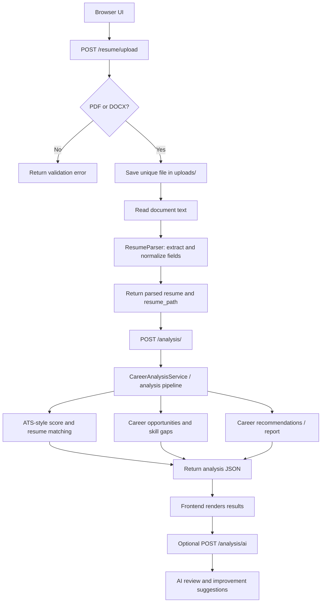
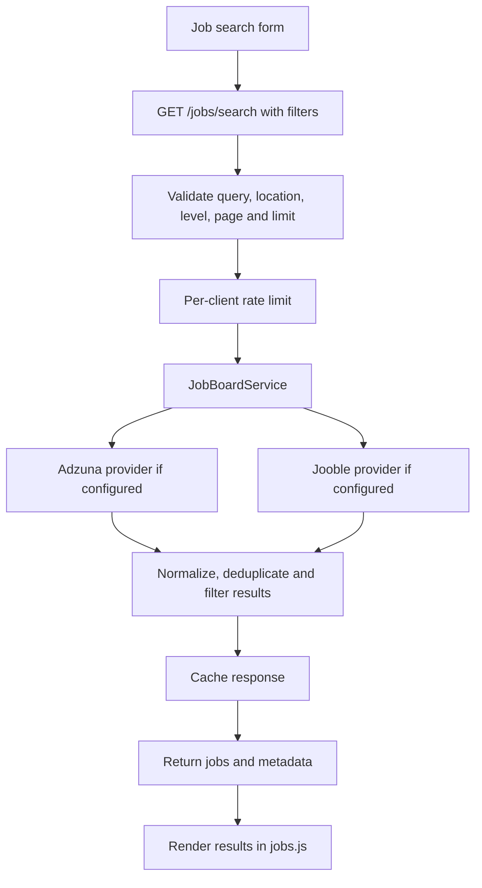

CareerPilot AI — Resume Analysis & Job Search Portal
🚀 Live Demo
Visit the live platform: https://resume-analysis-web-frontend.vercel.app/
The frontend is deployed on Vercel. Availability of resume analysis, job search, Google sign-in, and other backend-powered features depends on the configured API/backend services and provider credentials.
An AI-assisted career platform built with Python, FastAPI, vanilla JavaScript, HTML, and CSS. It combines resume parsing and analysis, ATS-style scoring, job discovery, skill-gap guidance, AI review/improvement suggestions, Google sign-in, and a private job-application tracker.
Project status: This README documents the source code in this repository archive. Provider credentials and deployment settings must be configured by each developer. External AI and job-search results depend on the availability and limits of those providers.

Contents
- What the project does
- Feature overview
- How the project works
- Architecture and folder structure
- Technology stack
- Run locally on Windows
- Environment variables
- API overview
- Testing
- Deployment notes
- Security and limitations
- Suggested improvements
What the project does
CareerPilot AI is designed to help a job seeker move through a practical job-search workflow:
1. Sign in with Google (when OAuth is configured).
2. Upload a resume in PDF or DOCX format.
3. Extract and normalize resume information into a structured profile.
4. Review resume quality, ATS-style signals, skills, experience, education, and career direction.
5. Search current job listings through configured job providers such as Adzuna and Jooble.
6. Compare a resume with a target role or job description and identify potential skill gaps.
7. Request AI-generated review and resume-improvement suggestions.
8. Track applications and their statuses in a personal application tracker.
The application is a career-support tool, not a hiring decision system. Scores and recommendations are estimates and should be reviewed by the user.
Feature overview
Feature	Implementation area	Notes
Resume upload	app/api/routes/resume.py	Accepts PDF and DOCX; stores the upload and returns a structured resume plus its server-side path.
Resume parsing	app/parser/, app/readers/, app/models/resume.py	Reads document text, extracts fields, normalizes data, and uses AI-assisted parsing where configured.
Resume / career analysis	app/api/routes/analysis.py, app/analysis/	Builds analysis results and career recommendations from the uploaded resume.
ATS-style scoring	app/ats/, app/matching/	Uses project-defined rules and matching logic; it is not an official score from any ATS vendor.
Job search	app/api/routes/jobs.py, app/jobs/job_board.py	Searches configured providers, applies filters, normalizes results, and caches recent searches.
Skill-gap and career guidance	app/career/, app/analysis/pipeline.py	Helps compare current profile signals with role requirements and suggest next steps.
AI review / improvement	app/reviewer/, app/improver/, app/services/ai_service.py	Optional AI-generated review and improvement ideas. Requires a configured AI provider.
Google sign-in	app/api/routes/auth.py	OAuth login, callback, current-session endpoint, and logout. Requires Google OAuth credentials.
Application tracker	app/api/routes/applications.py, app/tracker/	Create, list, update, delete, and summarize applications for the signed-in user. Supports SQLite and PostgreSQL connection configuration.
Browser UI	frontend/	Static HTML, CSS, and JavaScript served by FastAPI.

How the project works
A. Main user journey
1. Open the portal. FastAPI serves frontend/index.html from /. The browser loads style.css, theme.css, app.js, and the job-search script jobs.js through explicit routes in app/api/main.py.
2. Check sign-in state. The frontend calls GET /auth/me. If Google OAuth is configured, GET /auth/login starts the Google authorization flow and Google returns to /auth/callback. The callback stores basic user information in a signed session cookie. GET /auth/logout clears the session.
3. Upload a resume. The browser sends a multipart request to POST /resume/upload. The backend checks that the filename has a .pdf or .docx extension, saves it under uploads/ with a random unique filename, and invokes ResumeParser.
4. Read and parse the file. The parser uses document readers (app/readers/pdf_reader.py and docx_reader.py) and parsing/normalization logic to construct a structured Resume object. The endpoint returns the original filename, stored filename, local server path, and parsed resume data. If parsing fails, the upload is removed in the error paths.
5. Run core analysis. The frontend sends the returned resume_path (plus optional company, role, and job description) to POST /analysis/. CareerAnalysisService delegates to the analysis pipeline. The pipeline can combine resume parsing/profile data, ATS-style scoring, job/opportunity logic, matching, skill-gap analysis, and career recommendations.
6. Run the slower AI extras. The frontend can call POST /analysis/ai for AI review and resume-improvement tips. This is separated from the main analysis so the initial result can be returned without waiting for all AI extras.
7. Search jobs. The job-search UI sends search terms and filters to GET /jobs/search. The route validates inputs and applies an in-memory per-client rate limit. JobBoardService queries whichever providers are configured, normalizes and combines results, applies filters/sorting, and caches recent queries. The API exposes GET /jobs/status to report provider status without returning API keys.
8. Track applications. Signed-in users can save a job/application through POST /applications/, view their records with GET /applications/, check totals at GET /applications/statistics, update an entry with PUT /applications/{application_id}, and delete it with DELETE /applications/{application_id}. The backend derives the user ID from the session and scopes tracker operations to that user.
B. Resume upload and analysis sequence

C. Job search sequence

Architecture and folder structure
Resume-Analysis-Web.-main/
├── app/
│   ├── api/
│   │   ├── main.py                 # FastAPI app, middleware, static UI and router setup
│   │   ├── routes/                 # Auth, resume, analysis, jobs, tracker and health endpoints
│   │   └── schemas/                # Request/response data contracts
│   ├── analysis/                   # Career analysis service and pipeline/report assembly
│   ├── ats/                        # ATS-style scoring rules and score calculations
│   ├── career/                     # Career recommendations, opportunity and skill-gap logic
│   ├── core/                       # Configuration, prompts, logging, branding
│   ├── development/                # Development/mock resume helpers
│   ├── exceptions/                 # Custom exceptions
│   ├── improver/                   # Resume-improvement service and agent
│   ├── jobs/                       # Job board providers, search, normalization and matching
│   ├── matching/                   # Resume/job/skill/keyword/experience matching
│   ├── models/                     # Resume, job, report and career-profile models
│   ├── parser/                     # Resume and job parsing
│   ├── readers/                    # PDF/DOCX text readers
│   ├── reviewer/                   # AI resume review
│   ├── services/                   # AI and job opportunity services
│   ├── tracker/                    # Application tracker service and database access
│   ├── utils/                      # JSON extraction and shared helpers
│   └── validators/                 # Resume/job/review validation
├── frontend/
│   ├── index.html                  # Main web interface
│   ├── app.js                      # Main UI, auth, upload, analysis and tracker interactions
│   ├── jobs.js                     # Job search UI and filters
│   ├── style.css                   # Main styles
│   └── theme.css                   # Theme styles
├── tests/                          # Automated tests
├── .env.example                    # Environment variable template (safe placeholders)
├── requirements.txt                # Python dependencies
├── render.yaml                     # Render Blueprint configuration
├── Dockerfile                      # Container build/start configuration
├── Procfile                        # Process start command for compatible hosts
└── DEPLOY.md                       # Additional deployment instructions
Technology stack
- Backend: Python 3.12-compatible project, FastAPI, Uvicorn, Pydantic.
- Frontend: HTML, CSS, vanilla JavaScript (no frontend build step is specified in this archive).
- Resume documents: PDF and DOCX reading with pypdf / python-docx.
- AI integration: OpenRouter-compatible API configuration and AI SDK dependencies. The selected model is controlled by MODEL_NAME.
- Job data: Adzuna and optional Jooble integrations, enabled by API credentials.
- Authentication: Google OAuth via Authlib and Starlette session middleware.
- Application storage: SQLite by default, or PostgreSQL when DATABASE_URL is configured.
- Deployment: Render Blueprint and Dockerfile are included.
Run locally on Windows
1. Install prerequisites
Install Python 3.12 (recommended because the deployment configuration specifies Python 3.12.7) and Git. Open PowerShell in the project root — the folder containing requirements.txt and app/.
2. Create and activate a virtual environment
py -3.12 -m venv .venv
.\.venv\Scripts\Activate.ps1
If PowerShell blocks activation due to execution policy, you can run the activation script for the current terminal session using an appropriate user-approved policy, or use Command Prompt instead:
.venv\Scripts\activate.bat
3. Install dependencies
python -m pip install --upgrade pip
pip install -r requirements.txt
4. Create your local environment file
Copy-Item .env.example .env
Edit .env and add your own provider credentials. Do not commit .env to GitHub. At minimum, configure OPENROUTER_API_KEY for the AI-backed features; job search requires valid job-provider credentials, and Google sign-in requires Google OAuth credentials. See Environment variables.
5. Start the server
From the repository root:
python -m uvicorn app.api.main:app --reload --host 127.0.0.1 --port 8000
6. Open the application
- Portal: http://127.0.0.1:8000/
- API documentation: http://127.0.0.1:8000/docs
- Health check: http://127.0.0.1:8000/healthz
- Job provider status: http://127.0.0.1:8000/jobs/status
Keep the terminal running while using the portal. If a feature reports missing credentials, check the corresponding .env value and restart the server.
Environment variables
The complete template is .env.example. The most important variables are:
Variable	Purpose	Required for
OPENROUTER_API_KEY	Credential for configured AI model calls	AI-backed parsing/review/analysis paths; project config expects this key.
MODEL_NAME	Model identifier used by AI integration	Selects the model; defaults to the model in .env.example.
MAX_OUTPUT_TOKENS	General AI response budget	Controls output length/cost trade-off.
RESUME_PARSER_MAX_TOKENS	Resume parsing token budget	AI-assisted resume parsing.
AI_REVIEW_MAX_TOKENS	Review output budget	AI resume review/improvement.
ADZUNA_APP_ID, ADZUNA_APP_KEY	Adzuna credentials	Adzuna job searches.
JOOBLE_API_KEY	Jooble credential	Optional Jooble job searches.
ADZUNA_COUNTRY, ADZUNA_COUNTRIES	Country selection for Adzuna queries	Job search scope.
GOOGLE_CLIENT_ID, GOOGLE_CLIENT_SECRET	Google OAuth credentials	Google sign-in.
GOOGLE_REDIRECT_URI	OAuth callback URL; locally usually http://127.0.0.1:8000/auth/callback	Google sign-in. Must match the OAuth console configuration.
SESSION_SECRET	Signs session cookies	Set a long, stable random value, especially in production.
FRONTEND_URL, BASE_URL	Site/base URLs	OAuth redirects and URL configuration.
DATABASE_URL	PostgreSQL connection string	Persistent hosted application tracking. Leave blank to use SQLite.
DATABASE_PATH	Local SQLite file path	SQLite tracker storage.
DEVELOPMENT_MODE	Development behavior flag	Optional development configuration.

Never paste real API keys, OAuth secrets, database credentials, session secrets, or personal resumes into public issues or commits.
API overview
Method	Endpoint	Purpose
GET	/health/	Health response from the API router.
GET	/healthz	Deployment health check.
GET	/docs	Interactive Swagger API documentation.
GET	/auth/login	Start Google OAuth login.
GET	/auth/callback	OAuth callback and session creation.
GET	/auth/me	Check current sign-in state.
GET	/auth/logout	Clear the current session.
POST	/resume/upload	Upload and parse a PDF/DOCX resume.
POST	/analysis/	Run core resume/career analysis using the uploaded resume_path.
POST	/analysis/ai	Run the separate AI review/improvement stage.
GET	/jobs/status	Inspect job provider configuration/status without revealing keys.
GET	/jobs/search	Search jobs using query, location, level, remote, date, sort, page and limit filters.
POST	/applications/	Save an application for the signed-in user.
GET	/applications/	List the signed-in user's applications; optional status filter.
GET	/applications/statistics	Get application statistics for the signed-in user.
PUT	/applications/{application_id}	Update an application.
DELETE	/applications/{application_id}	Delete an application.

For exact request/response schemas, run the application and open /docs. Job search query parameters include q, location, level, remote, posted_within, sort, page, and limit.
Testing
Tests are in tests/, with an additional app/tests/ directory. From the repository root, run:
python -m pytest
Run a focused test file when debugging, for example:
python -m pytest tests/test_job_parser.py -q
python -m pytest tests/test_ats.py -q
python -m pytest tests/test_analysis_pipeline.py -q
Some tests may depend on environment configuration or external service behavior. This README does not claim that the suite passes in every environment; run the tests locally and review any failures against your configured providers and installed dependency versions.
Deployment notes
The repository includes render.yaml, Dockerfile, Procfile, and DEPLOY.md. For Render, the Blueprint uses uvicorn app.api.main:app and the /healthz health check. Configure secrets in the host dashboard rather than committing them.
Before deploying:
1. Add the required AI key and whichever job-provider credentials you intend to use.
2. Configure Google OAuth callback URLs for the deployed domain.
3. Set a stable SESSION_SECRET and ensure HTTPS/session settings are correct.
4. Configure PostgreSQL via DATABASE_URL if application data must persist across restarts. The .env.example warns that a local SQLite file may not survive restarts on ephemeral hosts.
5. Test login, resume upload, job search, and application CRUD against the deployed domain.
Hosting plan availability, sleep behavior, quotas, and pricing can change; check the hosting provider's current terms before relying on a free tier.
Security and limitations
- Resume uploads: the upload endpoint checks file extensions but this archive does not show a maximum upload-size check or malware scan. Add both before production use.
- Server-side file paths: upload responses include resume_path, and the analysis endpoint accepts that path. For a multi-user public deployment, replace client-supplied filesystem paths with opaque server-managed upload IDs tied to the authenticated user; validate ownership before analysis.
- Authentication boundaries: application-tracker endpoints require a signed-in session. Review whether resume upload/analysis/job features should also require authentication and enforce ownership for uploaded files.
- Rate limiting: job search has an in-memory per-process rate limit. It resets on restart and is not shared across multiple server instances; use a shared store/gateway for production scale.
- Provider availability: AI and job results depend on external API keys, quotas, latency, and service availability. Missing credentials can disable a provider or feature.
- Scores are estimates: ATS-style scores and matching logic are project-defined heuristics, not a guarantee of interview selection or a score from a specific applicant-tracking vendor.
- Privacy: resumes contain personal data. Define retention/deletion rules, restrict access, and avoid logging raw resume content or secrets.
- Production readiness: review error handling, request validation, rate limits, file storage, monitoring, OAuth configuration, and database backups before serving real users.
Suggested improvements
1. Introduce upload IDs and per-user file ownership instead of exposing filesystem paths to the browser.
2. Add upload size limits, stronger content-type/file-signature checks, and safe cleanup/retention jobs.
3. Add authentication and authorization policies consistently across resume-related endpoints.
4. Move job-search rate limiting and cache to Redis or another shared store if scaling horizontally.
5. Add CI that installs dependencies, runs tests, and checks formatting/type issues on every pull request.
6. Add structured API response schemas and consistent error response formats.
7. Add observability for AI/provider latency, quota failures, and job-search success rates without storing sensitive resume text.
8. Document the data model, expected provider quotas, and how users can delete their uploaded resume and application history.
Contributing
Issues and pull requests are welcome. For changes to API behavior, include tests and update this README or the API docs where relevant. Never include secrets, real user resumes, database files, or personal data in commits.
License
No license file was included in the supplied archive. Add a LICENSE file before presenting the repository as open source, and choose a license appropriate to how you want others to use the code.
